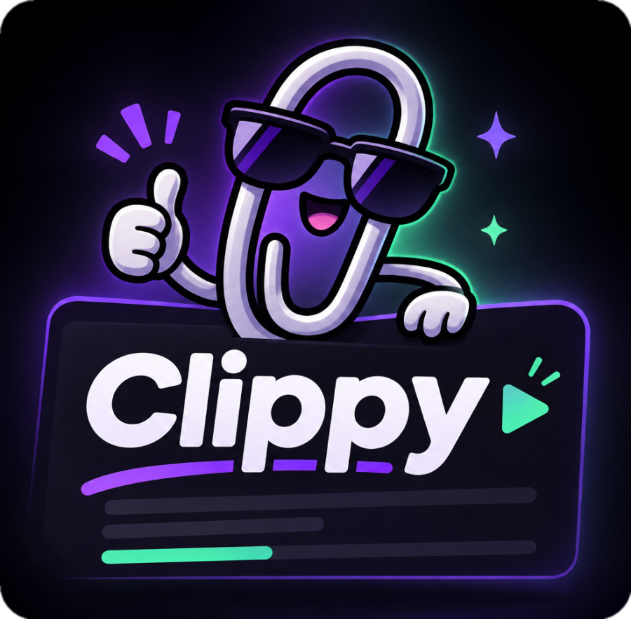

  <picture>
    <source media="(prefers-color-scheme: dark)" srcset="docs/clippy-dark.png">
    
  </picture>

# Clippy

Clippy finds the best moments in streams and videos, cuts them into vertical 1080x1920 Shorts, writes a short title and description, and posts them to **YouTube Shorts** and **TikTok**. It runs on your own Windows PC, with your own accounts and, optionally, your own AI key.

You choose a topic (a game or anything: "GTA 6", "Minecraft", "Elden Ring"), a list of streamers, or simply "whatever is trending right now". Clippy does the rest, or hands you finished clips to review first.

> **The most important thing to know:** Clippy gets better when **you review its clips**. Press 👍, 😐 or 👎 on every clip you look at. That is how it learns *your* taste. See [Review your clips: it is how Clippy learns](#review-your-clips-it-is-how-clippy-learns).

## What it does

- **Finds moments** from loudness jumps, excited voice, laughter, swearing, hype words, on-screen motion, YouTube's "most replayed" graph and live-chat reactions. An AI can also score the whole transcript window by window ("worth watching", funny first) and choose the exact start and end of the bit.
- **Sources:** YouTube videos and VODs, live streams (YouTube and Twitch) with chat-spike detection, Twitch top clips (the streamers on your list first, trending only as a backup), and any YouTube or Twitch link you paste ("Clip a link"). **Manual runs and Autopilot choose their source separately**: you can run videos by hand while Autopilot works on live streams only.
- **Cuts** 1080x1920 clips with word-by-word captions (swear words are masked in the captions only, the audio is never changed), the streamer's webcam on top and the game below when a webcam is found, or a blurred background when not. If the source already has burned-in subtitles, Clippy does not add its own on top.
- **Writes** a short catchy title or caption, the streamer's name and hashtags, with an AI (your own key: Gemini, any OpenAI-compatible endpoint, Anthropic, or a local model) or without one.
- **Scores every clip** with a star number you can hover to see why, and lets you set a **minimum score** (default 7; Clippy warns you if you go lower, and again below 5).
- **Never makes the same moment twice from the same streamer** (other streamers playing the same game are never treated as duplicates).

## Ready to post

Every finished clip waits in the dashboard with a preview (hover to play it muted). In three tidy rows you can:

- **Post** (private or public) or **Schedule** it with a dark calendar and a 12-hour or 24-hour time picker (your choice in Settings). Scheduled clips are posted while Clippy is running; a missed time is never posted late by surprise.
- **Edit text**, ask for a **New joke**, **Trim** it (the original is kept), or **Crop** it again with another layout.
- **Rate it** 👍 / 😐 / 👎 (with a reason for 👎), or **Remove** it. "Mark as not posted" lets you post a changed version again.
- Work fast with **keyboard shortcuts** (J/K, U, N, D, X, S, E, Del), **select several clips** at once, and **spread your liked clips over the next days** while respecting your daily limit and posting window.

## Review your clips: it is how Clippy learns

Clippy is not trained on anyone else's taste. It learns **yours**, from the clips you rate. This is the most valuable thing you can do for it, and it takes a few seconds per clip.

| You press | What it tells Clippy |
|---|---|
| 👍 | "This one stood out, find more like it." The strongest signal. |
| 👎 | "This one stood out as bad, avoid this." Also a strong signal. You can say why (boring, nudity, wrong crop, repeated joke). |
| 😐 | "I looked at it, it is fine either way." A light signal; it also tells Clippy that the clip is no longer waiting for you. |
| nothing | Almost no information. A clip you never rate teaches Clippy very little. |

**How much do you need?** Clippy starts using your taste once you have rated about **12 clips with at least 8 👍**. At first the nudge is small and grows as it becomes sure of the pattern. Later, Clippy also reads how your posted clips did (their views about 2 days after posting) as a weaker, second teacher. The more clips you rate, and the more honest you are (including the 👎), the better its choices get: which moments, which streamers, which kinds of reactions.

**Why bother?** Without ratings Clippy only uses its built-in rules. With ratings it learns things no rule can know, like which streamers fit your channel or what kind of funny you like. Clips you looked at no longer count as "waiting for you", so Autopilot keeps working instead of stopping when many clips pile up.

## Your learning file: keep it safe

What Clippy learns is stored in a few small files **on your own PC**:

| File | What is in it |
|---|---|
| `ratings.jsonl` | every 👍 / 😐 / 👎 you gave, with the signals Clippy saw in that moment (voice energy, AI score, length, streamer...) |
| `learned_weights.json` | what Clippy worked out from your ratings |
| `views.jsonl` | how your posted clips did after about 2 days |
| `seen_moments.jsonl` | which moments were already made, so the same one is not made twice |

These files are **the memory of your Clippy**, and they are worth protecting:

- **They never leave your PC and are never uploaded** (they are in `.gitignore` and not part of any release or update). Nothing is sent to the authors.
- **Deleting a clip does not delete what Clippy learned from it.** The rating is written down when you press the button (and again when you remove the clip), so you can clean up your Ready to post list freely.
- **They are lost** if you delete the Clippy folder or press **Start fresh** in the History learning card. To be safe, use **Settings, Backup, Download backup** now and then, and **Restore from a file** after a reinstall or on a new PC. The backup contains your settings and these learning files, never your sign-ins, API keys, videos or logs.

## Automation

- **Autopilot** finds and prepares clips by itself on your schedule: a posting window, posts per day, a minimum gap, and clips per run. **These limits are for automation only.** A run you start yourself (Run now, or live streams by hand) ignores all of them.
- **Auto-Post is OFF by default.** With it off, Autopilot only prepares clips for you to review. Turn it on and Clippy posts by itself.
- **It keeps working with the browser tab closed**: Clippy runs hidden in the background until you press Quit dashboard or the PC sleeps or restarts. Optionally, **Start with Windows** (only works while Autopilot is on, with a clear warning first) brings it back after a restart.
- **YouTube's daily upload limit** is remembered: until it resets, clips go to TikTok only and YouTube resumes by itself.
- **Stop now** ends a run but leaves Autopilot on (it waits about 20 minutes before its next automatic run). A failed run still switches Autopilot off, so it never retries the same error all night.
- Only **one Clippy dashboard** can run at a time, so a scheduled clip cannot be posted twice.

## Looking after itself

- A **health bar** at the top shows whether you are signed in, Chrome, ffmpeg and yt-dlp are found, your AI key works and there is disk space, with a fix button for each problem.
- Optional **Windows notifications** (off by default, local only) when a run finishes or a scheduled post is done or failed. Clicking one opens the dashboard.
- **Automatic updates** from this repository replace only program files, never your settings, clips or learning files, and **Go back to the previous version** is one click away.
- A **quick-start guide** walks new users through the first four steps.

## AI is optional

Clippy does not require an AI provider. AI integration is optional, and users can configure their own provider or local LLM. No AI credentials or user data are routed through the developer.

## Requirements

Windows 10 or 11, Google Chrome, Python 3.10+, ffmpeg and a JavaScript runtime for yt-dlp (Deno or Node.js). `setup.bat` checks for each and offers to install what is missing with winget.

## Start

1. Double-click `setup.bat` (installs into this folder only; asks before every download).
2. Double-click `dashboard.bat`, sign in to YouTube and TikTok once with the Sign in button, set your topic and streamers, press Save.
3. Press **Run now** (choose how many clips and whether to clip videos or live streams) and watch the log, or open **Clip a link** to clip one specific video.
4. **Review the clips and rate them.** That is the step that makes Clippy yours.

Autopilot and Auto-Post are OFF by default. In "Ready to post", the "Post as" choice defaults to private.

## What leaves your PC

Clippy can only connect to YouTube, TikTok, Twitch, the official Google / Gemini APIs and the one AI address you enter yourself. Everything else is blocked in code (`scripts/netguard.py`) and logged. There is no telemetry, no analytics, no server run by the authors, and no account. If you use an AI, the clip transcript, the source video's title, a few small frames and some chat messages are sent to that provider with your own key. Choose "No AI" to send nothing. Your ratings and everything Clippy learned stay on your PC.

The only other connections are one-time model downloads in `setup.bat` (speech model from huggingface.co, face model from github.com/opencv) after you confirm, the yt-dlp update check on pypi.org, and the update check on GitHub.

## Your secrets stay on your PC

API keys are stored encrypted with Windows DPAPI. Your YouTube and TikTok logins live in a dedicated Chrome profile inside the project folder. Never share `api_tokens/`, `chrome_profile/`, `autopost_config.json`, `autopost_state.json` or your learning files; the included `.gitignore` keeps them, your downloads and your clips out of git.

Run `.venv\Scripts\python.exe scripts\security_audit.py` to scan the code for dangerous patterns and list every web address it may contact.

## Use it responsibly

You are responsible for what you post. Clippy is free software: what you clip, edit, post, and where and how you use it is entirely your own responsibility, including following the rules of YouTube, TikTok, the streamers and any copyright or content laws that apply to you. Clip creators who allow it, credit them, and respect copyright. Clippy posts through a browser session of **your own** account, which platforms may restrict or limit (for example YouTube's daily upload limit); you use it at your own risk.

## Credits and license

Clippy grew out of the MIT-licensed project *gtavi-claudecode* by Bodila51 and is released under the same MIT license (see `LICENSE`). It builds on yt-dlp, faster-whisper, OpenCV (including the YuNet face-detection model from the OpenCV Zoo) and Playwright.
